{/* truncate */}

你 Vibe Coding 后得到的一大堆代码，你知道是什么作用吗？

有 AI 后公司要求每个人都是全栈，面对前端项目，你知道怎么下手吗？

本期我将以公司内部真实项目，给你科普前端技术，让你在使用 AI 时能够更加随心所欲，事半功倍。

好，那咱们开始吧！

---
Youtube 
<iframe
  src="https://www.youtube.com/embed/39JYtBzNONI"
  title="Vibe Coding 页面时, 你需要了解的前端技术科普"
  style={{width: '100%', aspectRatio: '16 / 9', border: 0}}
  allow="accelerometer; autoplay; clipboard-write; encrypted-media; gyroscope; picture-in-picture; web-share"
  allowFullScreen
/>
---
Bilibili
<iframe
  src="//player.bilibili.com/player.html?bvid=BV1szKZ6WE2M&page=1"
  title="Vibe Coding 页面时, 你需要了解的前端技术科普"
  style={{width: '100%', aspectRatio: '16 / 9', border: 0}}
  allow="accelerometer; autoplay; clipboard-write; encrypted-media; gyroscope; picture-in-picture; web-share"
  allowFullScreen
/>


## 浏览器只认识HCJ

我先告诉大家一个结论，浏览器只认识 HTML、CSS 和 JS 这三种语言。

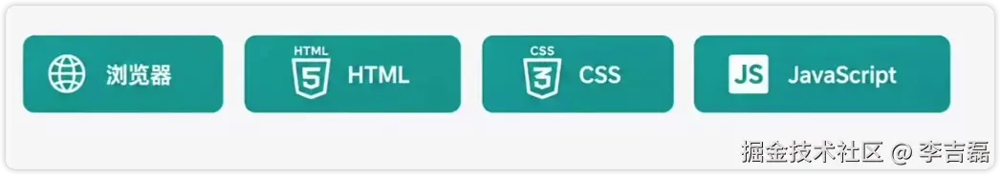

大家看一下这个页面的代码, 是不是非常复杂？它大概有 9000 行

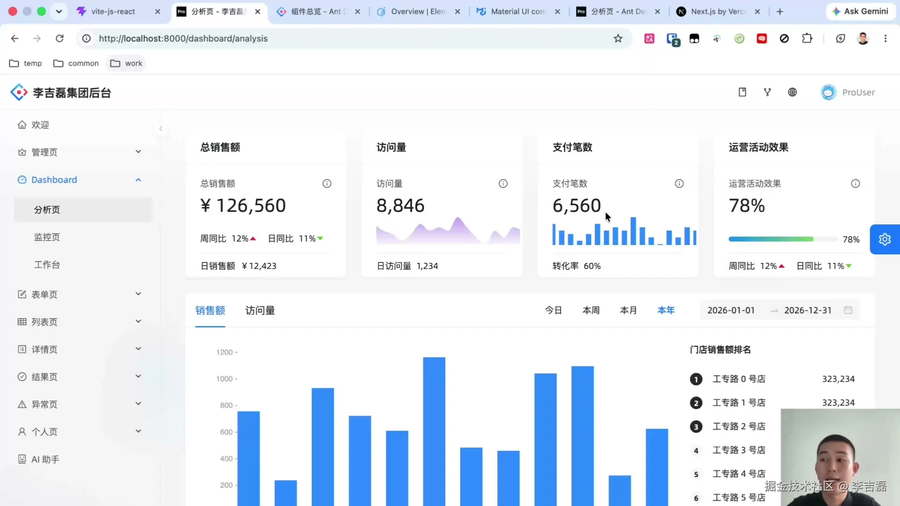

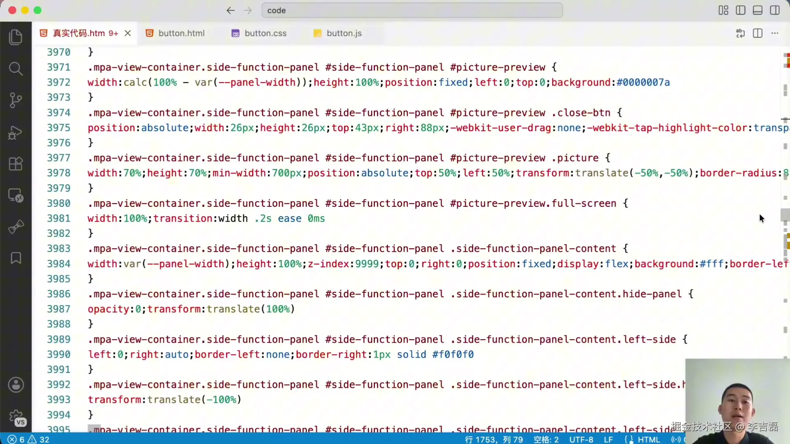

是不是完全没办法看懂, 那咱们简化一下.

这种开头是尖括号的代码叫做 HTML, 代表是一个按钮

```html
<button id="demoButton">一个按钮</button>
```


如果想让这个按钮变得漂亮一点，就需要使用 CSS. CSS 的代码如下所示。

你会发现这个按钮变成了蓝色底色、白色文字。

```css
button {
  color: white;
  background-color: #1677ff;
}
```


平时咱们看到的按钮，都是可以点击的，如果想让它有一些交互，就需要 JS. 咱们在 Js 中写到 “你好，我是 JS。” 写完 Js 代码后再点击, 你会发现它给了一个弹框，并且这个弹框内容写的是你好，我是 JS。

```js
button.addEventListener('click', function () {
  alert('你好, 我是 Js');
});
```

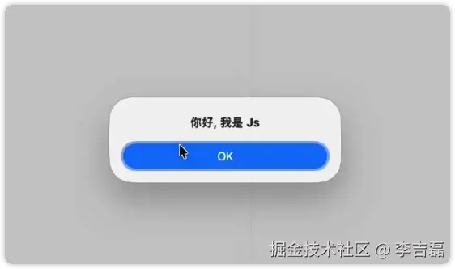

咱们现在已经学会了 HTML、CSS 和 JS，接下来我把这三种语言简称为 HCJ。

## 框架层

咱们会了 HCJ，那刚才的页面就会改了吗？很明显代码还是太复杂了，这根本不是人能写出来代码。

你可能会好奇，这代码不是人写的吗？

是也不是。

前辈们为了解决写出来代码浏览器能渲染，而且人类也能维护，发明了 React、Vue 和 Angular，统称为框架层。

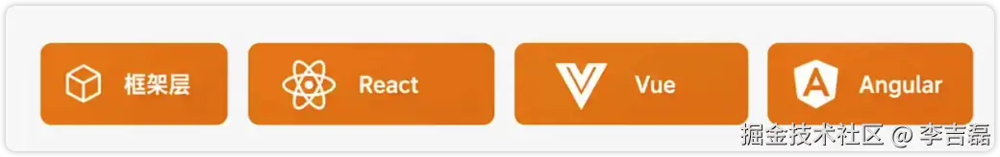

咱们接下来以 React 为例，这是我一个 Vibe Coding 出来的项目，你会发现它会有很多乱七八糟文件，这都不重要。

今天咱们先来看 `Button.jsx` 这个地方, 其实就是把 HCJ 这三种语言写到了同一个文件中.

你会发现这里面还是 `<button>`，但是把 CSS 写在了 button 里边，并且把 Js 代码也写在了 button 里边. 并且还把这个 button 还封装了单独的一个文件，叫做 button.jsx。

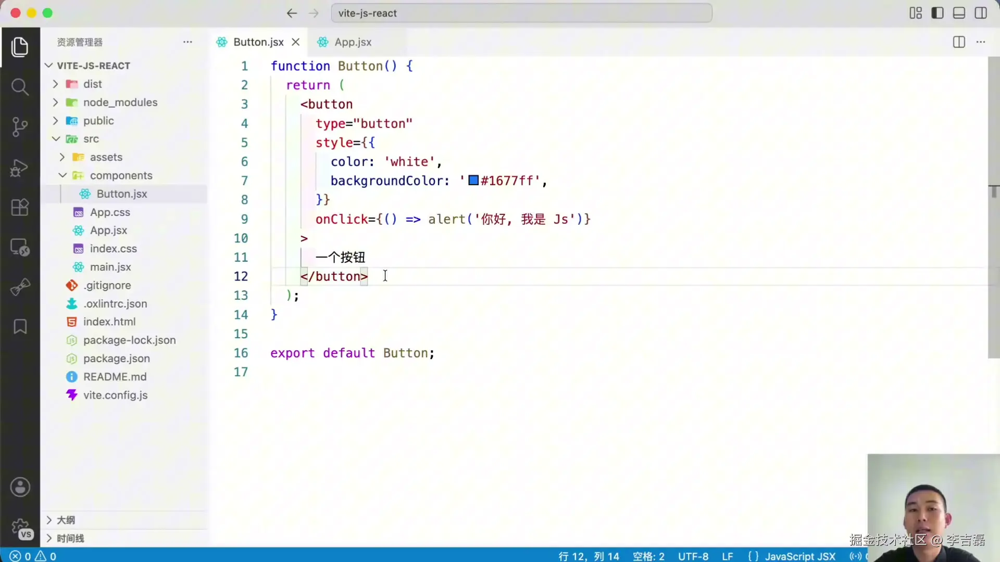

咱们去页面看一下效果。你会发现这和刚才用 HCJ 写的效果一样。点击也会有同样的效果。它的好处是什么呢？

首先, 它这三种语言写在了一块，非常好维护；

其次，当它想重复利用的时候，就可以直接复制。


## 构建工具

现在问题来了，这种写法是人能看懂，人喜欢的，但浏览器不认识，那怎么办呢？

所以就有人发明了 Node，Node 就可以把 React 转换成 HCJ。

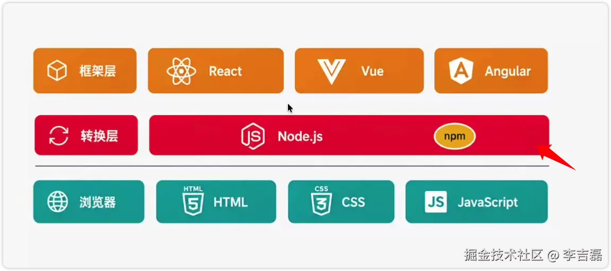

框架层有三种语言，Node 也不知道该怎么转换，这时候就有人又发明了 Vite。

Vite 说：“我来下达命令，你只需要像驴子拉磨一样，使劲的往前跑就行。”

Node 一听太好了，还主动拿出来小皮鞭 npm 说：“你可以通过 npm 这个小皮鞭来给我下达命令。”

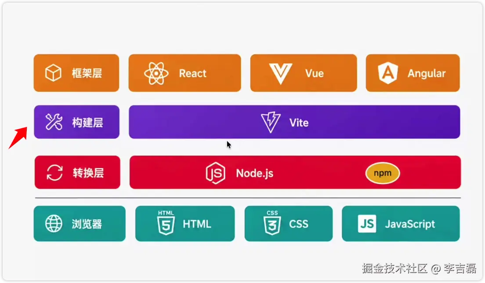

## 组件库

技术已经发展到这，这个世界就完美了吗？

事实是没有，因为还可以更好。人们写着写着，发现每个项目都需要按钮、表格、弹框这些组件。

这时候就有人站出来，他说：“我设计了一批漂亮实用的组件库，大家用我的吧。” 他给这个组件库起名叫做 Ant design。

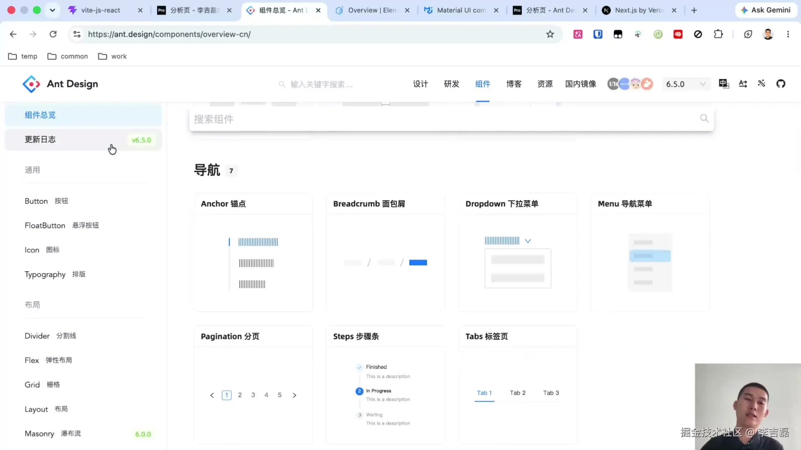

不光是他创造了组件库，还有人用 Vue 写了 Element plus，还有人写了 material UI 等等各种组件库。

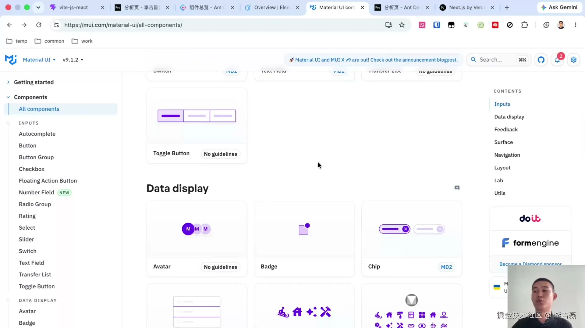

那现在这个世界就完美了吗？

事实是还没有，因为还可以更好。人们写着写着，发现好像每家公司都需要登录、人员信息、菜单权限等页面。所以发明 Ant design 的那个人又站出来说了：“我又写了一个项目，这个项目中封装了常见的登录页面、人员菜单管理权限、老板需要看的报表，叫做 Ant design Pro。”

我前司的后台管理页面，就是在 Ant design Pro 上改的。

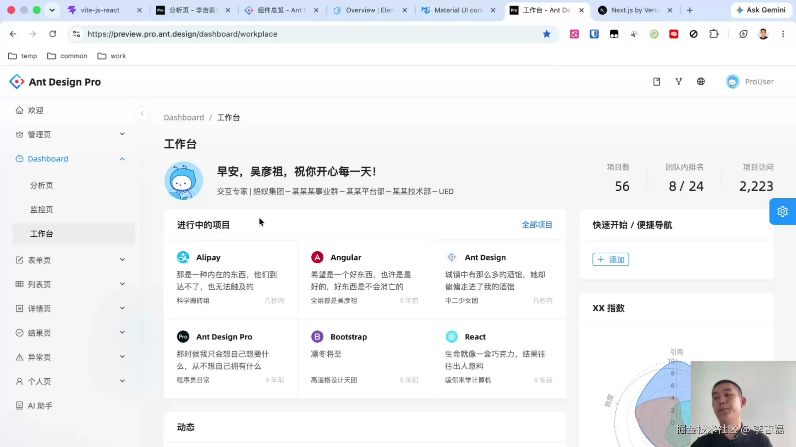

还有一家公司，他发布了一个项目叫做 Next.js，该项目提供了除了页面之外的所有东西，甚至包括部署平台。 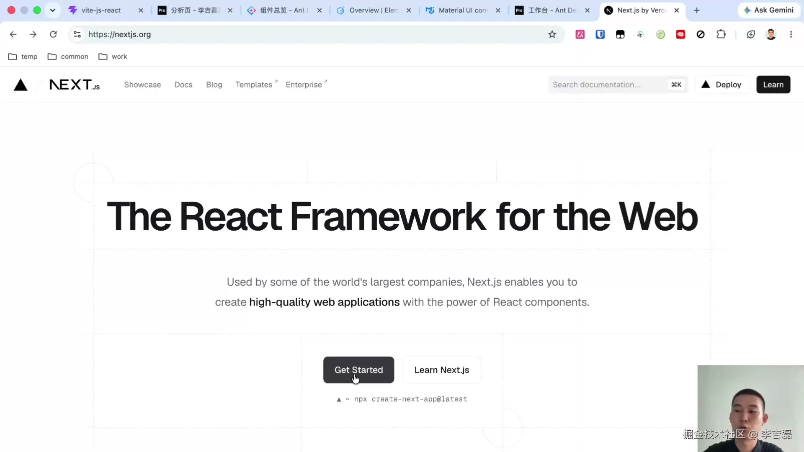

## AI 时代的编程最佳实践

世界总算完美了，但 AI 横空出世，惊艳了所有人。

理论上来说，AI 完全可以只用 HCJ 就能完成像 Ant design Pro 这样的项目。前提是需要有无限的 Token 和无限的时间去等待它穷尽所有代码的排列组合。

很明显这不现实。所以现在用 AI 的最佳实践，依然是让 AI 利用好当前人类已有的、积攒下来的工程经验去完成项目。AI 是一个需要人类驾驶的顶级赛车，这也是我做分享编程知识的原因：为未来培养更多更好的 AI 驾驶员。

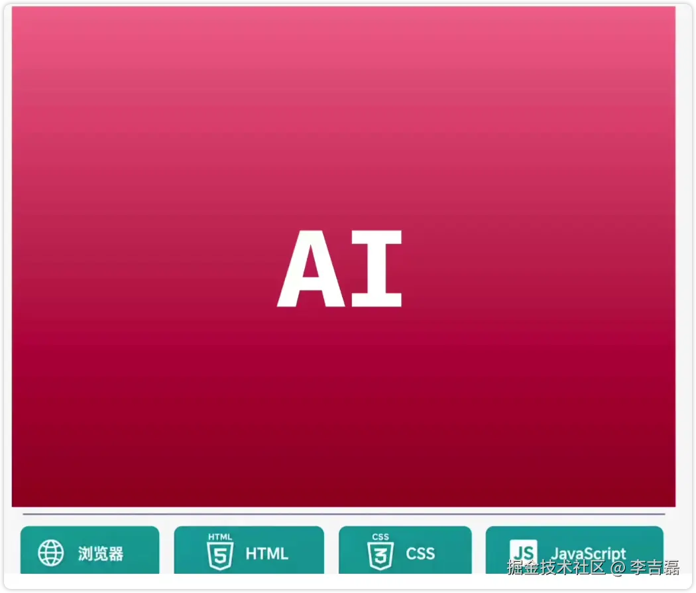

到这里, 你已经了解到了 Vibe Coding 时需要的基本前端知识。

你如果你想了解更多的前端知识, 可以让 AI 给你解释这张图, 会让你达到高级前端程序员的认知水平

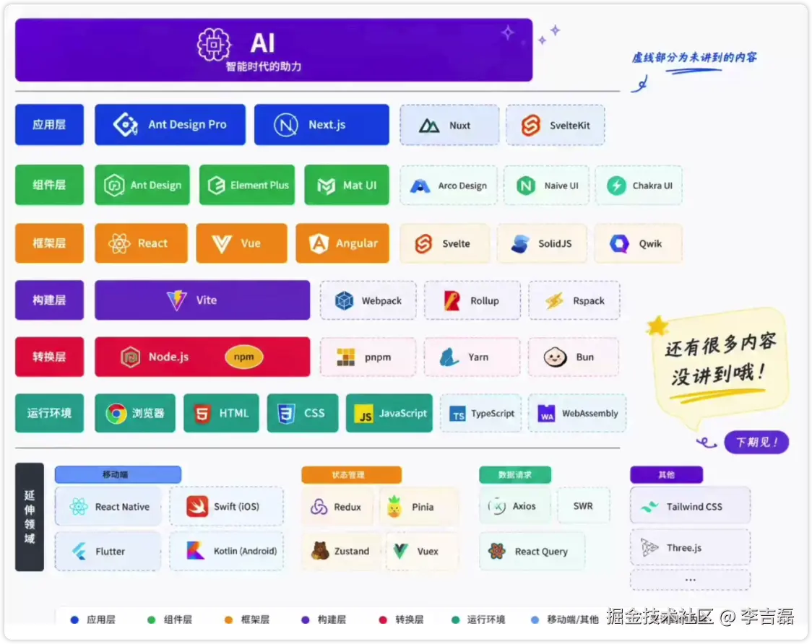