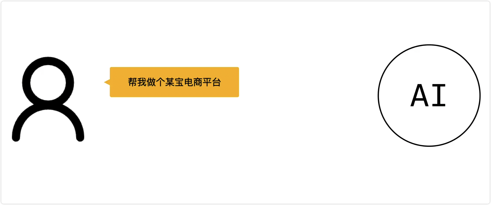
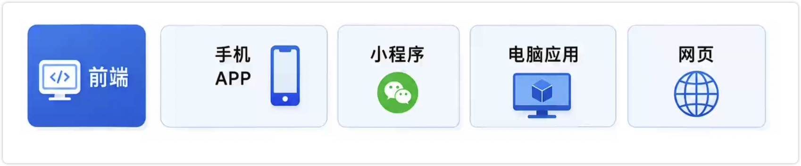
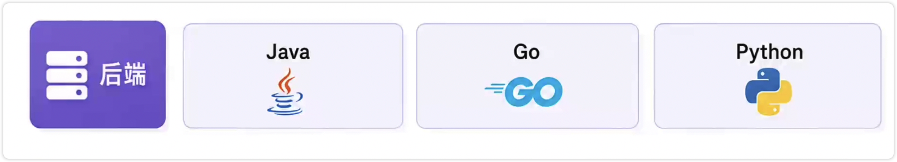
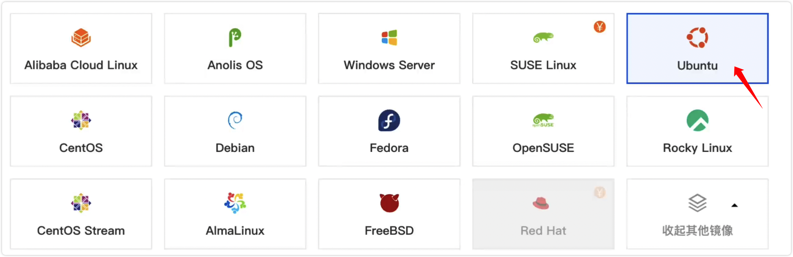
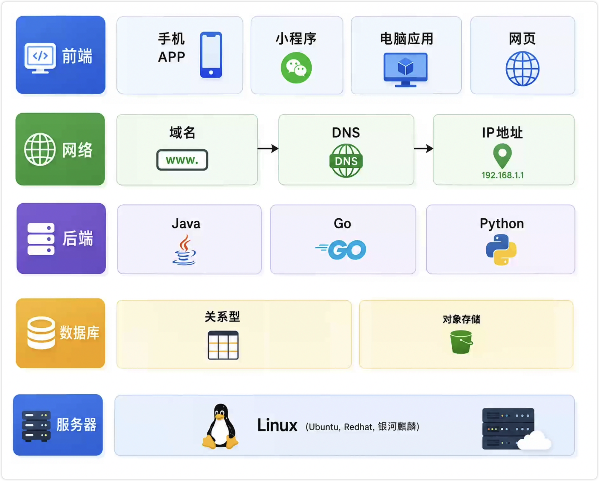

{/* truncate */}

假如你有一个绝妙的点子，可以让你变成下一个首富，比如说做个某宝电商平台。

当 Vibe Coding 结束后，你会纳闷**为什么我还没变成首富**? 

Why？

因为你的产品还没有发布，还没有用户使用。本期我就来告诉你，互联网是怎么运行的，用户怎么才能使用的上你的产品，Let's go！

---
Youtube 
<iframe
  src="https://www.youtube.com/embed/vvjvMg-8yAQ"
  title="你知道互联网是怎么运行的吗？"
  style={{width: '100%', aspectRatio: '16 / 9', border: 0}}
  allow="accelerometer; autoplay; clipboard-write; encrypted-media; gyroscope; picture-in-picture; web-share"
  allowFullScreen
/>
---
BiliBili
<iframe
  src="//player.bilibili.com/player.html?bvid=BV1EDM46aEfG&page=1"
  title="你知道互联网是怎么运行的吗？"
  style={{width: '100%', aspectRatio: '16 / 9', border: 0}}
  allow="accelerometer; autoplay; clipboard-write; encrypted-media; gyroscope; picture-in-picture; web-share"
  allowFullScreen
/>

## 前端

大家平时使用的手机 APP、小程序、浏览的网页，还有在电脑上 Vibe Coding 使用的电脑应用 codex 和 VS Code，我们可以把这些统称为前端。**前端的特点是运行在你本地设备上**。

如果你做的是一个记事本编辑器，这种纯本地运行的软件，它不需要网络，谁想用你就发送给他，那你的 Vibe Coding 到这里就结束了。

## 数据库

如果这个软件特别受欢迎，你想用它去挣一个小目标，这时候你就要需要记录下来哪些用户购买了你的应用。**而存放用户名、密码、邮箱这些用户信息的地方，称之为数据库。**

一个表格就是最简单的存储数据的形式，咱们使用的 Excel 就可以算是一种数据库。而给程序使用的数据库有 MySQL、PostgreSQL. 如果你不知道选什么，你就选 PostgreSQL，PostgreSQL 准没错。

使用表格来去存放文字的这种数据库形式，我们称之为关系性数据库。

如果想存储图片、视频、压缩包，这种不是文字的就需要使用对象存储，存储标准叫 S3。

## 后端

这时候数据已经存好了，用户使用的你的软件时，他需要登录，你需要校验他是否已经购买了你的应用。**这种判断的逻辑，我们一般称之为后端**。写后端最耳熟能详的语言呢，就是 Java。当然除了 Java 之外，还有 go、python 都是可以写后端的。

## 服务器与操作系统

现在前端、后端、数据库咱们都有了，那把产品发布吧。发布就是把这些程序部署在服务器上。

服务器什么？

服务器其实就是一台电脑。

咱们使用电脑时是需要显示器、键盘、鼠标，而运行程序只需要主机即可。**当有成千上万台主机部署在机房，为用户提供服务时，我们就叫它服务器**。

既然服务器是电脑，那它就需要操作系统，服务器上最常见的操作系统是 Linux。不过当你真正去买服务器的时候，你会发现没有 Linux 这个选项，因为 Linux 是一个类别的称呼，相对于 windows 和苹果电脑 MacOS 而言。 如果你不知道该选哪个 Linux 发行版，你就选 Ubuntu 就可以。

## 域名与IP地址

你知道前端、后端、数据库和服务器，他们是怎么连接的吗？

你可能会回答，它们当时是用网线连接的。

对，没错。

我想问的是，世界上有这么多的前端、后端、服务器，他们怎么唯一识别对方的？

其实**使用的是 IP 地址**。IP 地址就相当于咱们的身份证号，可以用来区分这个 IP 在哪个国家，哪个省哪个市。IP 地址是给程序使用的，**咱们人能接触到的都是域名**，比如说 bing.com、google.com，这些就是域名，相当于咱们人的名字。

怎么从名字找到 IP 地址呢？

这种映射关系是通过 DNS 来去找的。

## 结语

现在你已经知道了`<互联网是怎么运行的>`。你会发现有了 AI 只是让你不写代码，也能做一个产品出来，但**不等于就有了阿拉丁神灯，你做的产品依然需要去推广去运营。**

如果你喜欢我的内容, 烦请给我一个免费的赞, 这是对我的最大鼓励