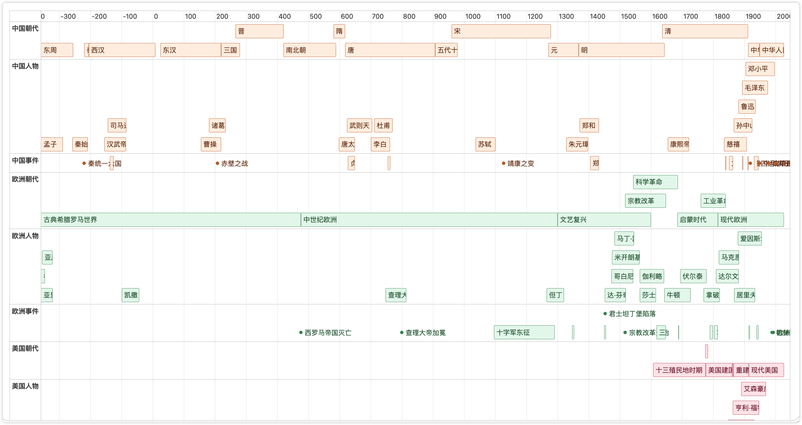
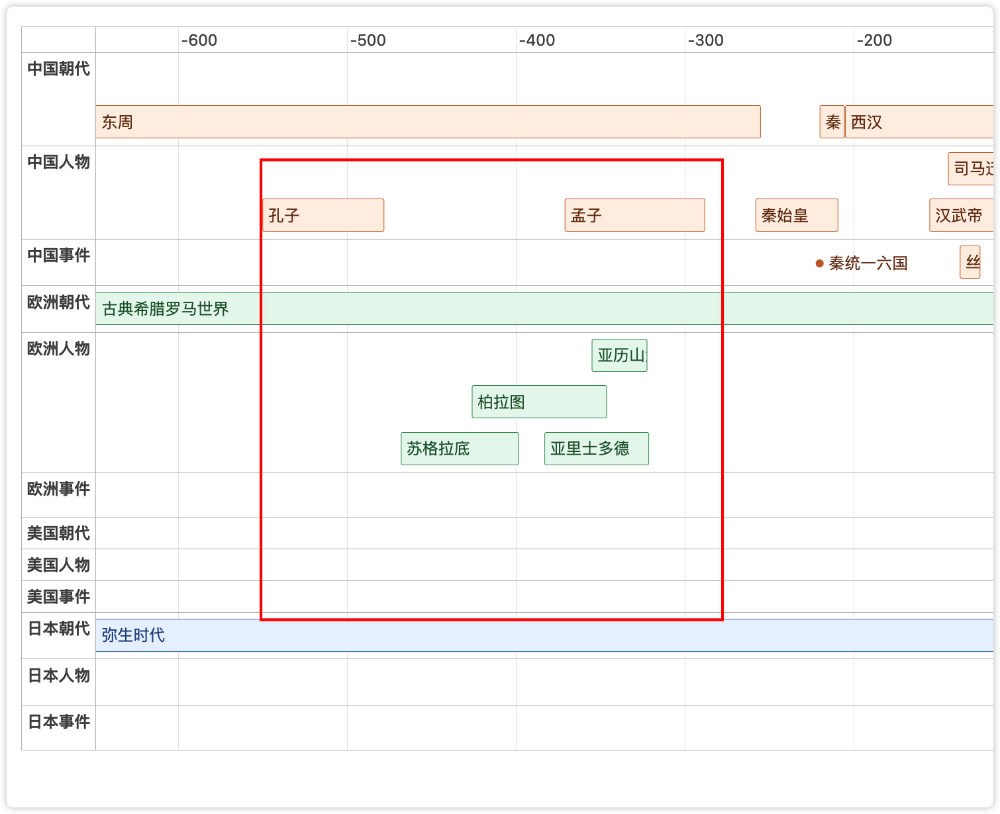
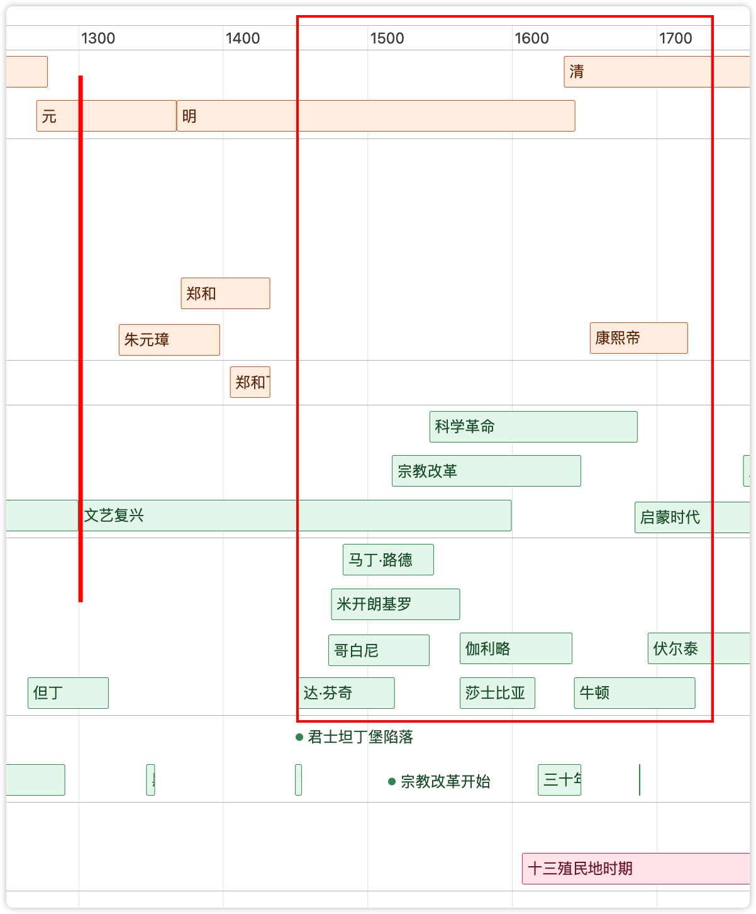
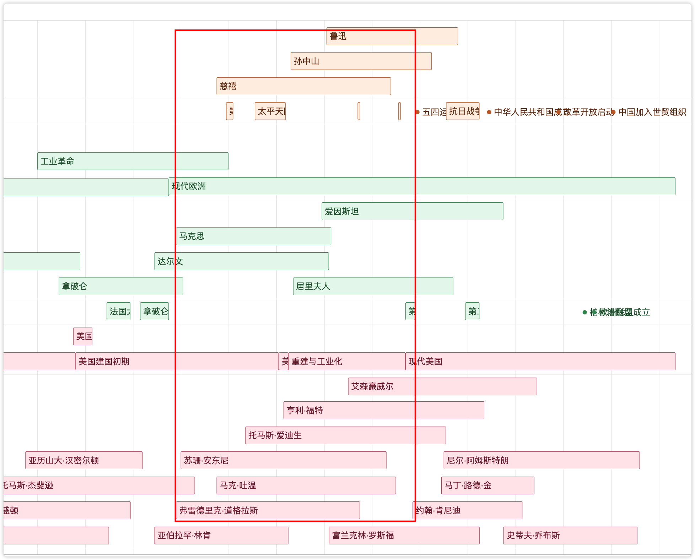

{/* truncate */}

## 世界历史时间线(可在线动态体验)

慈禧喝过可乐, 坐过汽车

阿基米德要翘起地球时, 秦始皇刚统一六国

孔子孟子和苏格拉底柏拉图亚里士多德一块讨论哲学

欧洲文艺复兴, 开始以人为本, 成吉思汗刚烧杀抢掠, 建立元朝

哥白尼的日心说发表时, 朱元璋的九子夺嫡刚有结果

伽利略牛顿在奠定物理基本规律时, 清朝入主中原

达尔文居里夫人马克思和慈禧各自努力

爱因斯坦在探索宇宙, 爱迪生在发明灯泡, 马克吐温在写小说, 福特在流水线造汽车, 孙中山鲁迅在忙着驱除鞑虏, 恢复中华

前后买了四本世界史，还是稀里糊涂，故这两天做了一个小项目, 欢迎体验, 请点击这[世界历史时间线在线体验](https://timeline.leolee.tech/)

如果你想添加事件参与项目, 请点击[Github](https://github.com/LeoLeeTech/History-Timeline),  https://github.com/LeoLeeTech/History-Timeline

#### 世界历史时间线整体缩略图

#### 中国先秦人物与古希腊人物的时间对照

#### 中国明清时期与欧洲文艺复兴、科学革命的时间对照

#### 中国、欧洲和美国近现代人物的时间对照

